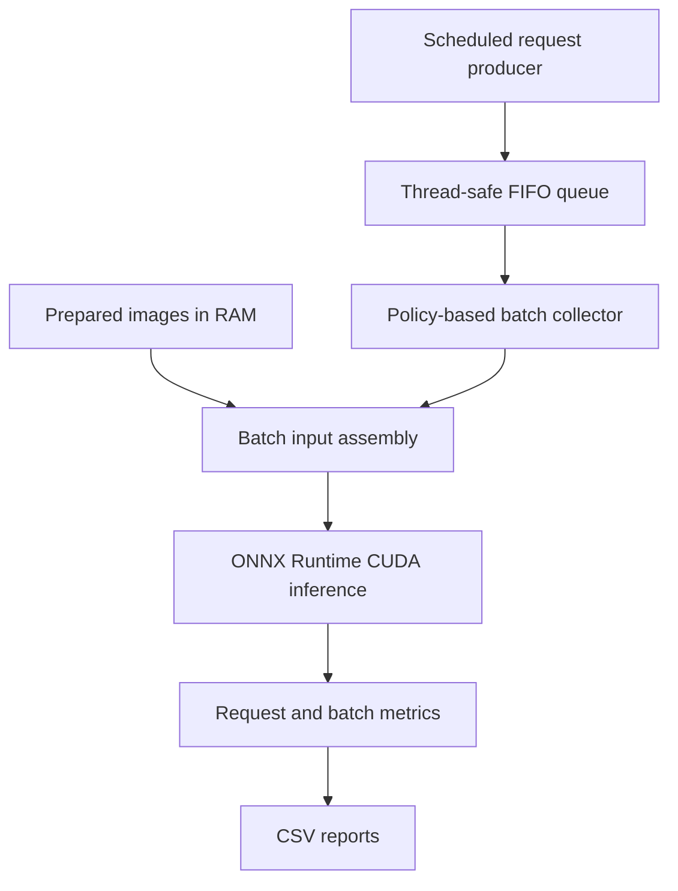

# ResNet-50 GPU Inference: A Batching Policy Benchmark

A C++17 benchmark comparing **Static, Dynamic, and Adaptive batching** for ResNet-50 inference using ONNX Runtime and CUDA.

The project investigates how batch capacity and request arrival patterns affect throughput, tail latency, and completion within a **100 ms latency target**. It combines a thread-safe request queue, scheduled workloads, real ImageNet inputs, and request-level timing.

**180 measured runs · 180,000 request completions · 5 batch capacities · 4 workloads**

This is a reimplementation and extension of my [earlier P3 project](https://github.com/lucy980509/adaptive-batching-gpu-inference), with revised policies, a batch-capacity sweep, and more detailed timing analysis.

## Key findings

- **Larger batches reduced backlog under high load.** Increasing Static capacity from 1 to 16 increased completed throughput from **193.48 to 326.88 requests/s** and reduced P95 from **2,063.61 to 100.40 ms**.
- **Full-batch collection was expensive at low load.** At capacity 16, Static had P95 **689.29 ms**, compared with Adaptive's **47.23 ms**.
- **Burst structure affected the appropriate capacity.** Eight-request bursts performed well at capacity 8, while capacity-16 Static waited across bursts.
- **Adaptive did not always win.** At capacity 16 under high load, Static completed **94.40%** within 100 ms, compared with Adaptive's **85.50%**.

All reported aggregate values are means of three per-run metrics.


*Mean per-run P95 in milliseconds. Lower is better; the color scale is logarithmic.*

## 1. Model and dataset

| Item | Configuration |
|---|---|
| Model | ResNet-50, `ResNet50_Weights.IMAGENET1K_V2` |
| Export | FP32 ONNX model, opset 18 |
| Input | `input`: float32 `[N, 3, 224, 224]` |
| Output | `logits`: `[N, 1000]` |
| Dataset | 1,000 distinct ImageNet validation images |
| Sampling | Random selection without replacement, NumPy seed 42 |
| Input storage | Little-endian float32, `[1000, 3, 224, 224]`, approximately 602 MB |

The [dataset preparation script](https://github.com/lucy980509/adaptive-batching-gpu-inference/blob/main/scripts/prepare_imagenet_subset.py) selects from the 50,000-image validation split of Hugging Face `ILSVRC/imagenet-1k`, using dataset revision `49e2ee26f3810fb5a7536bbf732a7b07389a47b5`. Image content and model predictions are not used for selection.

Preprocessing follows the pretrained weights:

- Convert to RGB.
- Resize the shorter edge to 232 with bilinear interpolation.
- Center-crop to 224 × 224 and scale to `[0, 1]`.
- Normalize with mean `[0.485, 0.456, 0.406]` and standard deviation `[0.229, 0.224, 0.225]`.

Images are loaded into RAM before measured runs. Each request stores an image index, and all policies use the same image sequence. The engine copies selected images into a reusable contiguous input buffer before inference.

This benchmark measures serving performance; classification accuracy is not evaluated. Model export settings, hashes, and separate CPU conversion checks are available in [export_report.json](models/resnet50/export_report.json).

## 2. System design

The application uses one producer thread, one batch-collection/inference thread, and one reusable ONNX Runtime session.



The queue uses `std::mutex` and `std::condition_variable`, supporting blocking, deadline-based, and nonblocking dequeue operations.

Closing the queue rejects new requests and wakes consumers. Pending requests are drained, including a final partial batch. Each run verifies the completed request count and propagates producer-thread exceptions after joining the thread.

Inference calls execute sequentially at the application level.

## 3. Workloads

| Workload | Scheduled interval | Requests per group | Nominal offered rate |
|---|---:|---:|---:|
| Low | 40 ms | 1 | 25 requests/s |
| Medium | 12 ms | 1 | 83.33 requests/s |
| High | 3 ms | 1 | 333.33 requests/s |
| Bursty | 120 ms | 8 | 66.67 requests/s |

Every run contains **1,000 requests**. Bursty therefore contains 125 groups of eight requests, enqueued sequentially within each group.

Arrival times are generated from an absolute schedule:

```text
scheduled_arrival(i) =
    start + interval × floor(i / burst_size)
```

The producer uses `sleep_until()` and does not intentionally wait for previous inference completion. A 20 ms preparation lead-in precedes the scheduled start and is excluded from measured elapsed time.

Actual enqueueing may occur after the scheduled arrival. This lateness is recorded and included in end-to-end latency; the schedule is not reset when the producer falls behind.

## 4. Batching policies

All policies first wait for one request. Maximum batch capacity `B` is swept across **1, 2, 4, 8, and 16**.

| Policy | Collection behavior |
|---|---|
| **Static** | Wait until `B` requests are collected; allow a partial batch at shutdown |
| **Dynamic** | Collect up to `B` requests using a fixed 20 ms collection deadline |
| **Adaptive** | Collect available requests immediately and limit additional waiting using queue state and the remaining latency budget |

These definitions apply to this implementation.

### Static

Static has no collection timeout. For example, at low load with capacity 16, the first request waits approximately `15 × 40 = 600 ms` for the remaining requests, before execution begins.

### Dynamic

After obtaining the first request:

```text
collection_deadline = now + 20 ms
```

The deadline is shared across the batch rather than restarted per request. Requests enqueued after the deadline are left for a later batch.

### Adaptive

After taking the first request:

```text
wait_budget =
    5 ms if the queue is empty, otherwise 20 ms

inference_budget = warmup_estimate + 2 ms

slo_deadline =
    oldest.scheduled_arrival + 100 ms - inference_budget

collection_deadline =
    min(now + wait_budget, slo_deadline)
```

Adaptive first drains immediately available requests with `try_pop()`, up to capacity. If none is available, it waits for new requests only while the deadline permits.

**Queued requests can still be collected after the deadline.** An expired deadline stops additional waiting; it does not discard requests or force available backlog into single-request batches.

The deadline is computed once per batch. The policy uses queue emptiness, not an exact queue-depth estimate. The 100 ms target, waiting budgets, and 2 ms margin are experimental parameters rather than guaranteed service bounds.

## 5. Experimental protocol

| Dimension | Configuration |
|---|---|
| Maximum batch capacity | 1, 2, 4, 8, 16 |
| Policies | Static, Dynamic, Adaptive |
| Workloads | Low, medium, high, bursty |
| Repetitions | 3 per configuration |
| Requests per run | 1,000 |
| Total measured runs | `5 × 3 × 4 × 3 = 180` |
| Total request completions | 180,000 |

Each executable invocation evaluates one compiled capacity: **36 runs and 36,000 request completions**.

Before each run, every batch size from 1 through `B` is executed three times. The first pass is excluded from estimation; the largest per-size average of passes two and three becomes `warmup_estimate`.

Warmup is outside measured runs and reuses the engine's existing buffer without assembling real-image batches. Its estimate therefore excludes image-copy cost included in measured execution.

Policy order rotates across repetitions. The engine/session is reused, while capacities are evaluated separately without randomized capacity order. Measurements include the finite workload and final queue draining.

## 6. Metrics

Timestamps use `std::chrono::steady_clock`.

| Metric | Measurement boundary |
|---|---|
| `arrival_delay_ms` | Scheduled arrival → enqueue |
| `wake_delay_ms` | Scheduled arrival → timestamp sampled after `sleep_until()` |
| `enqueue_after_wake_ms` | Wakeup sample → enqueue |
| `queue_wait_ms` | Enqueue → dequeue |
| `batch_wait_ms` | Dequeue → batch engine call |
| `inference_ms` | Start → completion of the batch engine call |
| `latency_ms` | Scheduled arrival → batch completion |

Within rounding:

```text
latency =
    arrival_delay + queue_wait + batch_wait + inference
```

**Measurement scope:** preprocessing and disk loading are excluded. Batch execution includes CPU image copies, tensor setup, and ONNX Runtime execution—not GPU kernel time alone. Requests in the same batch receive the full batch execution duration.

Summary metrics include:

- **P50/P95/P99:** nearest-rank request-latency percentiles.
- **SLO attainment:** percentage of requests with latency ≤ 100 ms.
- **Completed throughput:** completed requests divided by time from scheduled start to last completion.
- **Mean batch size:** completed requests divided by executed batches.
- **Mean queue/batch wait:** request-weighted averages.

Low-load throughput can be arrival-limited. It should not be interpreted as maximum GPU capacity.

## 7. Results and interpretation

Raw measurements are available in [results/](results/). Tables report arithmetic means of three per-run metrics; mean per-run P95 is not a pooled percentile.

### High-load capacity sweep


*Points are three-run means. Bands indicate observed minimum–maximum values, not confidence intervals. P95 uses a logarithmic axis.*

The high workload offers approximately **333 requests/s**. Small batches complete work more slowly, causing queue growth. Increasing capacity narrows this gap:

| Maximum batch | Static throughput | Dynamic throughput | Adaptive throughput | Static P95 | Dynamic P95 | Adaptive P95 |
|---:|---:|---:|---:|---:|---:|---:|
| 1 | 193.48 | 193.28 | 193.22 | 2,063.61 | 2,069.05 | 2,071.00 |
| 2 | 238.81 | 239.49 | 237.61 | 1,134.12 | 1,122.34 | 1,146.80 |
| 4 | 278.90 | 279.29 | 278.19 | 566.12 | 561.06 | 575.46 |
| 8 | 296.01 | 294.89 | 294.76 | 375.89 | 379.66 | 380.99 |
| 16 | 326.88 | 325.64 | 325.31 | 100.40 | 101.59 | 105.30 |

*High workload. Throughput: requests/s; P95 latency: ms. Values are means of three runs.*

At capacity 1, all policies execute without additional collection, so their behavior is effectively equivalent.

### Capacity 16 across workloads

| Workload | Policy | P95 (ms) | Within 100 ms (%) |
|---|---|---:|---:|
| Low | Static | 689.29 | 5.70 |
| Low | Dynamic | 112.63 | 78.43 |
| Low | Adaptive | 47.23 | 100.00 |
| Medium | Static | 252.79 | 16.73 |
| Medium | Dynamic | 111.44 | 84.50 |
| Medium | Adaptive | 91.13 | 98.47 |
| High | Static | 100.40 | 94.40 |
| High | Dynamic | 101.59 | 92.90 |
| High | Adaptive | 105.30 | 85.50 |
| Bursty | Static | 218.09 | 48.00 |
| Bursty | Dynamic | 88.05 | 100.00 |
| Bursty | Adaptive | 87.87 | 100.00 |

### Where latency accumulates


*Bars show request-weighted means across 3,000 requests per workload/policy. This is a mean decomposition, not a P95 decomposition.*

- **Low:** Adaptive avoids waiting for a full large batch. However, capacity-1 baselines still have lower P95, around 32 ms, demonstrating the cost of additional waiting.
- **Medium:** Capacity-2 Static achieves P95 **35.72 ms** with **100%** within target. Adaptive improves on large fixed batches but does not outperform every smaller fixed configuration.
- **High:** At capacity 16, Adaptive has shorter mean batch wait than Static (**0.53 vs 1.37 ms**) but longer queue wait (**27.60 vs 21.67 ms**). Less collection waiting does not necessarily mean lower end-to-end latency.
- **Bursty:** Capacity 8 matches the eight-request bursts; all policies achieve P95 near **57 ms** and **100%** within target. Capacity-16 Static waits across bursts and increases latency.

**The main finding is a workload-dependent trade-off:** batch capacity, offered rate, and burst structure jointly determine performance. Adaptive is not consistently superior.

## 8. Repository structure

### Directories

| Path | Contents |
|---|---|
| `include/` | Interfaces, request/result structures, queue implementation, shared settings |
| `src/` | Workload generation, batching, inference, benchmarking, dataset loading, metrics |
| `models/resnet50/` | Export metadata; model binaries are prepared separately |
| `data/imagenet/` | Local prepared dataset, excluded from Git |
| `results/results_batchN/` | Recorded measurements for maximum capacity `N` |
| `assets/figures/` | Generated PNG/SVG figures |
| `scripts/` | Figure generation script |
| `CMakeLists.txt` | Build configuration and dependency linking |

### Main modules

| Header / source | Responsibility |
|---|---|
| `request.hpp` | Timestamps, clock aliases, image index |
| `request_queue.hpp` | Thread-safe FIFO and shutdown |
| `request_generator.hpp/.cpp` | Workload definitions and scheduled requests |
| `batcher.hpp/.cpp` | Policy definitions and batch collection |
| `inference_engine.hpp/.cpp` | CUDA session, input assembly, execution, warmup |
| `dataset.hpp/.cpp` | Prepared-image loading and size checks |
| `benchmark.hpp/.cpp` | Producer lifecycle, execution timing, completion checks |
| `metrics.hpp/.cpp` | Result structures, aggregation, CSV output |
| `main.cpp` | Data loading and experiment orchestration |

Each capacity's result directory contains:

| File | Records |
|---|---|
| `benchmark_summary.csv` | 36 measured-run summaries |
| `benchmark_batches.csv` | One row per executed batch |
| `benchmark_requests.csv` | 36,000 request-completion records |

Batch capacity is encoded in directory names, not CSV columns. Preserve that association when combining results.

## 9. Build and reproduce

### Requirements and assets

Recorded experiments used Windows, MSVC Release/C++17, CMake, an NVIDIA GTX 1660 SUPER (6 GB), ONNX Runtime GPU 1.26.0, CUDA 12.6, and cuDNN 9.8.

Prepare these files relative to the repository root:

```text
models/resnet50/resnet50_v2_fp32.onnx
models/resnet50/resnet50_v2_fp32.onnx.data
data/imagenet/val1000_resnet50_v2_nchw_f32.bin
```

Model/data binaries are excluded from Git. Preparation tools remain in the earlier project:

- [Model preparation](https://github.com/lucy980509/adaptive-batching-gpu-inference/blob/main/scripts/prepare_resnet50.py)
- [Dataset preparation](https://github.com/lucy980509/adaptive-batching-gpu-inference/blob/main/scripts/prepare_imagenet_subset.py)
- [Preparation dependencies](https://github.com/lucy980509/adaptive-batching-gpu-inference/blob/main/scripts/requirements-resnet.txt)

Follow their environment instructions and ImageNet access terms. Retain the generated selection/manifest files for dataset provenance.

### Build and execute

Run from the repository root in PowerShell, adjusting dependency paths:

```powershell
cmake -S . -B build -A x64 `
  -DONNXRUNTIME_DIR="C:/onnxruntime/onnxruntime-win-x64-gpu-1.26.0" `
  -DCUDA_BIN_DIR="C:/Program Files/NVIDIA GPU Computing Toolkit/CUDA/v12.6/bin" `
  -DCUDNN_BIN_DIR="C:/Program Files/NVIDIA/CUDNN/v9.8/bin/12.8"

cmake --build build --config Release
.\build\Release\p3_inference.exe
```

**Keep the working directory at the repository root** for relative model/data paths.

Each invocation writes the three benchmark CSVs to the working directory, overwriting files of the same names.

### Configure the sweep

| Setting | Location |
|---|---|
| Maximum batch capacity and SLO | `include/batcher.hpp` |
| Collection waits and margin | `src/batcher.cpp` |
| Request count and repetitions | `src/main.cpp` |
| Arrival intervals and burst sizes | `src/request_generator.cpp` |
| Dataset path and size | `include/dataset.hpp` |

Set `max_batch_size` to **1, 2, 4, 8, and 16**, rebuilding and running after each change. Keep the other settings unchanged; `request_count` is 1,000 for the reported results.

For example, after running capacity 16:

```powershell
New-Item -ItemType Directory -Path .\results\results_batch16 -Force
Copy-Item .\benchmark_*.csv -Destination .\results\results_batch16\ -Force
```

## 10. Limitations

- **Coverage:** One GPU, four deterministic workloads, and three repetitions do not establish long-term stability or performance on other systems.
- **Timing:** Host scheduling affects measurements. Execution timing includes input copies and runtime overhead; GPU kernels and transfers are not separately profiled.
- **Adaptive estimate:** A cross-size warmup estimate excludes input-copy cost. Changing capacity can also change this estimate; the policy does not guarantee the latency target.
- **System scope:** The pipeline is in-process and single-GPU, with an unbounded queue and no admission control.